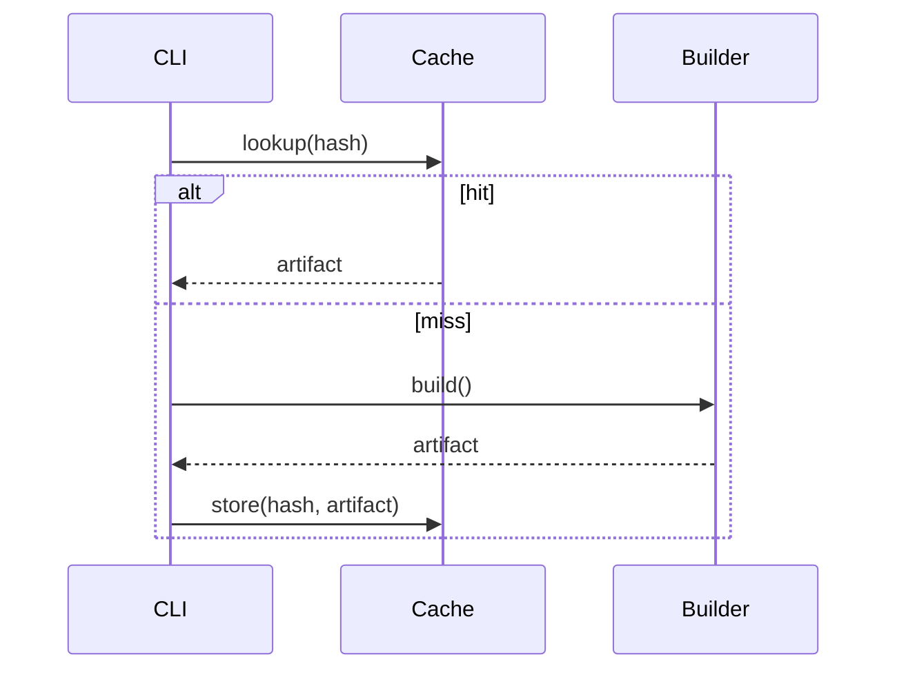

# Cache design notes

How the build cache decides when an artifact can be reused.

## Hit rate

For $n$ builds with $h$ cache hits, the hit rate is $r = h / n$. The expected build time is

$$
E[T] = r \cdot T_{\text{hit}} + (1 - r) \cdot T_{\text{miss}}
$$

> [!TIP]
> Raising the hit rate from 60% to 90% cuts the average build time by more than half when $T_{\text{miss}} \gg T_{\text{hit}}$.

## Request flow



## Key

```python
def cache_key(inputs: list[bytes]) -> str:
    h = hashlib.sha256()
    for chunk in sorted(inputs):
        h.update(chunk)
    return h.hexdigest()
```
