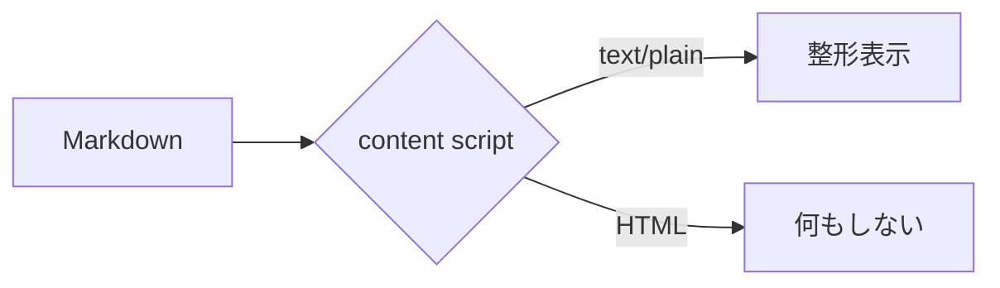
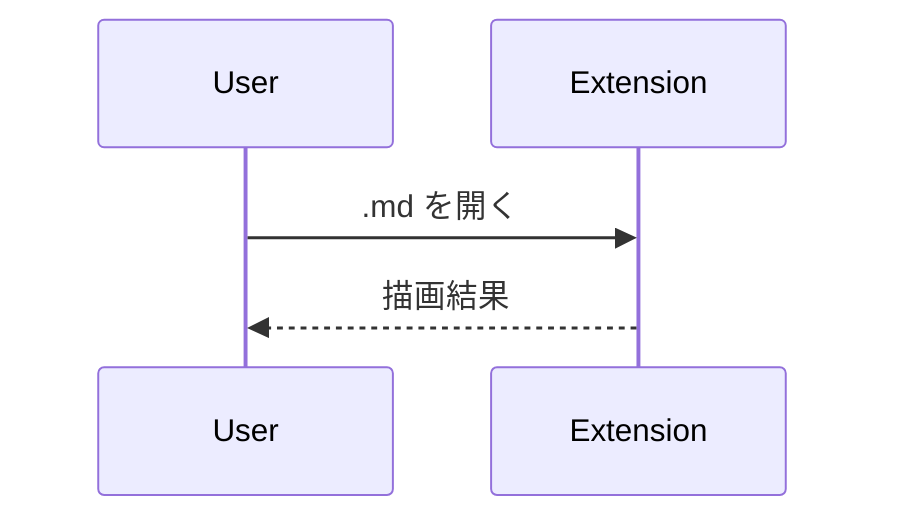

# Mark Viewport サンプル

これは **Mark Viewport** の表示確認用ファイルです。`inline code` や [リンク](https://example.com)、https://example.org の自動リンクも確認します。

## リストとタスク

- 項目 A
- 項目 B
  - ネスト 1
  - ネスト 2

1. 一番目
2. 二番目

- [x] 完了したタスク
- [ ] 未完了のタスク

## コード

```ts
interface User {
  id: number;
  name: string;
}

export function greet(user: User): string {
  // コメント
  return `Hello, ${user.name}!`;
}
```

```python
def fib(n: int) -> int:
    return n if n < 2 else fib(n - 1) + fib(n - 2)
```

## 表

| 機能 | 対応 | 備考 |
| :--- | :---: | ---: |
| GFM 表 | ✅ | 左右中央揃え |
| 脚注 | ✅ | 下を参照[^1] |
| 打ち消し線 | ✅ | ~~消した文字~~ |

## Mermaid





```mermaid
graph TD
  this is not valid -->
```

## 数式

インライン数式 $E = mc^2$ と $\sqrt{a^2 + b^2}$。価格の $5 と $10 は数式になりません。

$$
\int_0^\infty e^{-x^2}\,dx = \frac{\sqrt{\pi}}{2}
$$

```math
\sum_{k=1}^{n} k = \frac{n(n+1)}{2}
```

1 行の表示数式: $$a^2 + b^2 = c^2$$

## アラート

> [!NOTE]
> 補足情報です。

> [!TIP]
> 便利なヒント。

> [!IMPORTANT]
> 重要な情報。

> [!WARNING]
> 注意が必要です。

> [!CAUTION]
> 危険な操作です。

## 絵文字

:tada: :rocket: :+1: は変換し、:) はそのまま。

## 引用と区切り

> 引用文です。
> 複数行にまたがります。

---

### 小見出し

<kbd>Ctrl</kbd> + <kbd>C</kbd> でコピー。

<script>alert('XSS')</script>


### 同じ見出し

### 同じ見出し

[^1]: 脚注の本文です。
